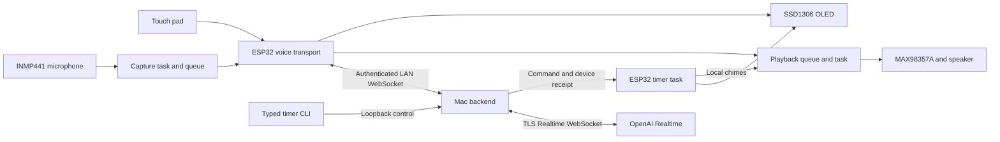

# Architecture

[Documentation home](Home.md) · [Protocol](Protocol.md)

## System boundary



The Mac owns API credentials, Realtime sessions, voice, personality, output gain, and command coordination. The ESP32 owns physical input/output, accepted countdown deadlines, and local completion audio. After the ESP32 accepts a timer, its completion does not need the Mac, API, or Wi-Fi.

## Firmware responsibilities

| Component | Responsibility |
| --- | --- |
| `src/main.cpp` | Hardware initialization, touch debounce, OLED rendering, diagnostics, PCM-to-I²S output |
| `src/voice_transport.cpp` | Wi-Fi/WebSocket state, push-to-talk messages, timer receipts, playback credits |
| `src/capture_stream.cpp` | Dedicated priority-2 microphone task and bounded PCM queue |
| `src/playback_stream.cpp` | Priority-3 audio output task, playback prebuffer, local alarm, progress reporting |
| `src/focus_timer.cpp` | Priority-2 local timer task, monotonic deadline, snapshots, one-shot completion |
| `include/focus_clock.h` | Platform-independent timer rules, also compiled in native tests |

The tasks run on ESP32 core 1. Networking is handled from the Arduino loop; workers do not send WebSocket messages. Shared task state is protected by FreeRTOS mutexes and queues. Touch I/O is digital GPIO33 with a 25 ms stable-change filter, not the ESP32 `touchRead` peripheral.

## Audio format and buffers

The voice build's I²S bus is Philips stereo with two 32-bit slots at 24 kHz. The INMP441's high-aligned 24-bit slot0 is converted to signed PCM16, mono, little-endian for the network. Reply PCM16 is expanded into identical left/right 32-bit output slots. There is no software sample-rate conversion in the current 24 kHz voice path.

| Buffer or limit | Current value |
| --- | --- |
| Hardware DMA | Eight 128-frame buffers per direction, approximately 43 ms at 24 kHz |
| Capture queue | 64 PCM16 blocks of 128 samples, approximately 341 ms |
| Outbound input packet | Up to 2048 PCM bytes, approximately 43 ms |
| Reply packet | Up to 1024 PCM bytes, approximately 21 ms |
| Playback queue | 32 packets, bounded device memory |
| Initial playback prebuffer | 10,240 PCM bytes, approximately 213 ms |
| Playback startup alternatives | End-of-audio for a short reply, or a 500 ms fallback after first data |
| Negotiated playback window | 16 packets in flight; legacy devices default to one |
| Maximum held input | 15 seconds |
| Minimum committed input | 100 ms of samples |
| Maximum generated reply audio | 30 seconds |

Independent capture prevents a slow network send or OLED redraw from starving microphone DMA. Independent playback and a credit window prevent network round trips from pacing each small audio write. Credits are reported in batches from the main loop after the playback worker consumes packets into I²S. Ready is withheld until the queue and DMA have drained.

The offline bench target keeps 16 kHz I²S, a PCM24 meter, and 100 kHz OLED transfers. The voice target uses 400 kHz during OLED frame transfers and a PCM16 idle meter.

## Voice lifecycle

1. ESP32 joins Wi-Fi, authenticates to the Mac, and advertises capabilities.
2. Backend opens/configures Realtime with automatic turn detection disabled, then sends Ready.
3. An accepted touch press begins a turn. The capture queue is reset to avoid retaining idle samples.
4. While held, the device batches and streams PCM. On release it stops tagging the turn and flushes queued audio and its final partial packet.
5. Backend commits the input; only after the commit acknowledgement does it request a response.
6. Realtime audio deltas are decoded, volume-adjusted, packetized, and sent within the device's credit window.
7. ESP32 prebuffers and plays the reply. End-of-audio releases short replies from the prebuffer wait.
8. The worker drains output. Final credits and `playback_done` go to the Mac; the Mac then sends Ready.

A new touch does not interrupt an ongoing reply. Failed/stalled turns are discarded rather than automatically replayed after reconnecting.

## Timer lifecycle

```mermaid
sequenceDiagram
    participant CLI as Mac timer CLI
    participant Mac as Mac backend
    participant ESP as ESP32 timer
    participant Audio as Local playback task
    CLI->>Mac: start_timer with request ID and seconds
    Mac->>ESP: start_timer
    ESP->>ESP: Accept deadline in monotonic clock
    ESP-->>Mac: timer_result accepted
    Mac-->>CLI: device_confirmed
    Note over ESP,Audio: Wi-Fi may disconnect after acceptance
    ESP->>ESP: Deadline expires; mark completed
    ESP->>Audio: Play local two-chime alarm
```

The timer task checks the 64-bit monotonic deadline every 20 ms. It does not wait on network I/O. Alarm playback takes priority over remote voice audio and can interrupt a voice session. Countdown state lives in RAM; a reset/power loss cancels it. There is no current cancellation command or persistent timer journal.

## Backend responsibilities

| File | Responsibility |
| --- | --- |
| `backend/server.mjs` | Read local environment/personality and start the listener |
| `backend/bridge.mjs` | Authentication, voice state machine, Realtime bridge, playback credits, timer receipt routing |
| `backend/timer.mjs` | Typed start/status client over loopback |
| `backend/setup.mjs` | Generate matching local device tokens and configuration files |
| `backend/personality.txt` | Conversational behavior and current action restrictions |
| `backend/.env.example` | Non-secret configuration template |

Local echo retains one bounded turn in memory, corrects its recording level, and plays it back. Realtime mode streams the input onward during a hold. The backend does not write audio files or log transcripts. A process/session reconnect loses prior AI conversation context.
